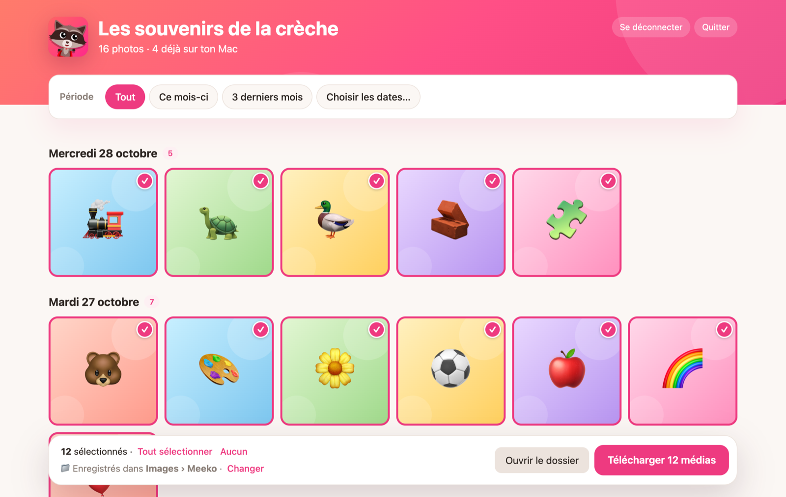
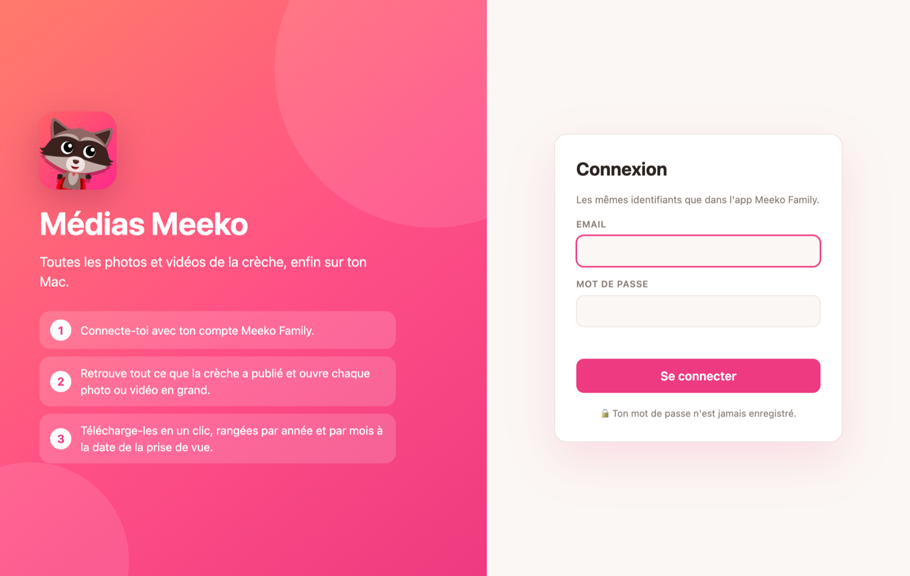

<div align="center">


# Médias Meeko

**Toutes les photos et vidéos de la crèche, enfin sur ton Mac.**

Récupère en un clic les médias publiés par la crèche sur Meeko Family,
rangés par année et par mois à la date de la prise de vue.

[**⬇️ Télécharger pour macOS**](https://github.com/zeii/Medias-Meeko/raw/main/dist/Medias-Meeko.zip)

<sub>macOS 12 ou plus récent · Apple Silicon et Intel · rien d'autre à installer</sub>

<br>



</div>

---

## Ce que ça fait

| | |
|---|---|
| 🔐 **Connexion Meeko Family** | Les mêmes identifiants que dans l'app officielle. Le mot de passe n'est jamais enregistré. |
| 🗓️ **Choix de la période** | Tout l'historique, ce mois-ci, les 3 derniers mois ou des dates précises. |
| 🖼️ **Galerie par jour** | Chaque photo ou vidéo s'ouvre en grand, avec navigation au clavier (← → Échap). |
| ✅ **Sélection fine** | Les nouveautés sont pré-cochées, ce qui est déjà sur ton Mac est signalé. |
| 📁 **Rangement automatique** | `Images/Meeko/2026/10/2026-10-28_153000_1234.jpg`, date de fichier = date de prise de vue. |
| 🔁 **Sans doublon** | Relancer ne retélécharge que ce qui manque. |

<div align="center">

</div>

## Installation

1. [Télécharge le zip](https://github.com/zeii/Medias-Meeko/raw/main/dist/Medias-Meeko.zip), décompresse-le.
2. Glisse **Médias Meeko.app** dans le dossier **Applications**.
3. Premier lancement : l'app n'est pas signée par Apple, macOS la bloque.
   - Double-clique sur l'app, ferme le message d'alerte.
   - Ouvre **Réglages Système › Confidentialité et sécurité**, descends en bas, clique **Ouvrir quand même** à côté de Médias Meeko, puis confirme.
   - Sur un macOS plus ancien : clic droit sur l'app › **Ouvrir** › **Ouvrir**.

Ensuite, un double-clic suffit.

## Utilisation

1. Connecte-toi avec ton compte Meeko Family.
2. Choisis une période.
3. Clique sur une miniature pour la voir en grand, sur le rond en haut à droite pour la (dé)sélectionner.
4. **Télécharger** enregistre les médias dans `Images/Meeko` (modifiable via **Changer**).

## Confidentialité

- Tout se passe sur ton Mac : l'app parle directement à l'API Meeko, aucun serveur intermédiaire.
- Le mot de passe n'est jamais stocké. Seul le jeton de connexion Meeko est gardé dans `~/.config/meeko/token.json` (droits `600`).
- **Se déconnecter** supprime ce jeton.

## Pour les développeurs

Trois façons de s'en servir, qui partagent le même jeton de connexion :

| Fichier | Rôle |
|---|---|
| [`macos/MediasMeeko.swift`](macos/MediasMeeko.swift) | App native : `ui.html` dans une WKWebView, les appels `/api/*` implémentés en Swift. |
| [`ui.html`](ui.html) | Interface unique, utilisée par l'app native comme par la version Python. |
| [`meeko_ui.py`](meeko_ui.py) | Même interface servie en local (`http://127.0.0.1:8765`), Python 3 seul. |
| [`meeko_download.py`](meeko_download.py) | Ligne de commande. |
| [`make_app.sh`](make_app.sh) | Compile l'app universelle (arm64 + x86_64), l'installe dans `/Applications` et produit `dist/Medias-Meeko.zip`. |

### Compiler l'app

Nécessite les Command Line Tools Xcode (`swiftc`, `lipo`, `iconutil`).

```bash
./make_app.sh
```

### Interface web locale

```bash
python3 meeko_ui.py
```

### Ligne de commande

```bash
python3 meeko_download.py 2026-09-01 --until 2026-09-30 -o ~/Pictures/Meeko
```

Options : `--dry-run` pour lister sans télécharger, `--relogin` pour ignorer le jeton en cache, `--email` (ou `MEEKO_EMAIL` / `MEEKO_PASSWORD`).

---

<sub>Projet perso, non affilié à Meeko. Les captures d'écran utilisent des images factices.</sub>
